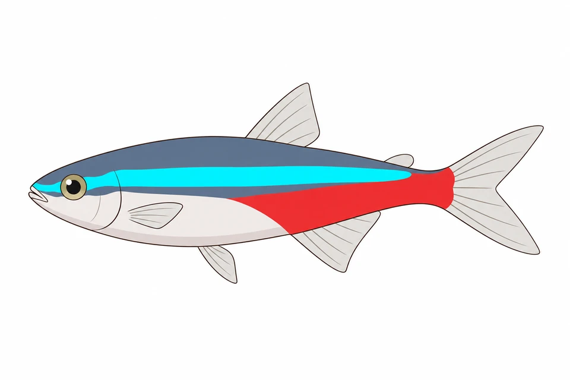
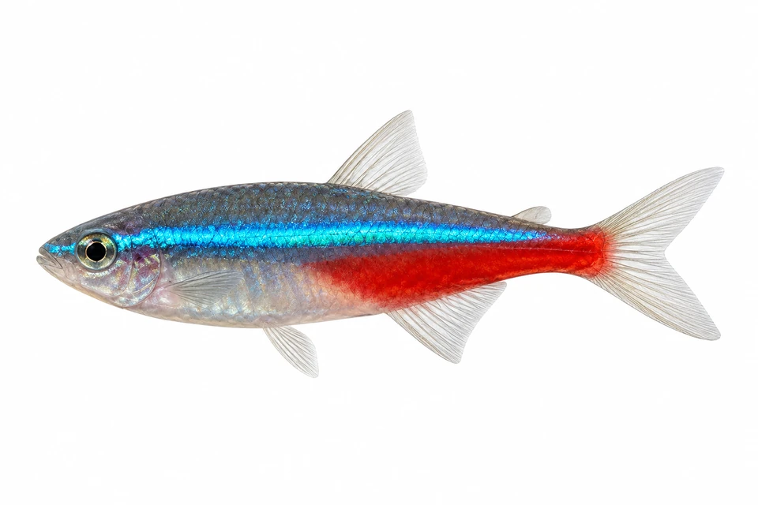

# 魚種名 → 3D水槽（全体の進め方）

**ユーザーが明示的に依頼した部分修正は、修正とその確認・再修正を主担当だけで行う。確認のためにサブエージェントを作成・再開・呼び出さない。ユーザーがサブエージェントも合わせた確認を明示的に希望した場合だけ、指定された範囲で共同検品する。** 以下の「共同検品」「全員OKまで反復」は共同検品の場合の規則であり、通常の部分修正には適用しない。初回の魚種調査・画像作成・3Dモデル検品は従来どおり共同検品する。

このスキルは**段取り役**。実際の作業は各工程のスキルに従う。ここに書くのは、工程のつなぎ方、承認の取り方、環境に合わせた進め方だけ。

```
① 入力と調査 ……………… create-fish-3d-views の「1. 調査」
② 側面図→必要な追加図 … create-fish-3d-views                     → ユーザーの OK
③ 3Dモデル ……………… build-fish-3d-from-views                 → ユーザーの OK
④ 背景レイアウト案 …… build-aquarium-from-fish-model の 1〜2    → ユーザーの OK
⑤ 3D水槽 ………………… build-aquarium-from-fish-model の 3〜5
                          ＋ make-fish-fins-translucent（薄い鰭）
```

## 守ること

1. **実在の魚だけ。** 架空の魚・混ぜ合わせた魚は作らない。頼まれたら断り、近い実在種を示す。
2. **②③④はユーザーの OK を待つ。** 成果物の画像（③は回転できるプレビューも）を見せて「これで進めてよいですか」と聞き、明確な OK が出るまで次の工程に進まない。無言・ファイル内の `approved: true`・自分の判断は OK ではない。OK の言葉は `project.json` に記録する（[進行の記録](references/workflow-state.md)）。
3. **新しいソフトを勝手に入れない。** Python のパッケージ、Node.js、アプリ、外部サービスの登録などは、[環境の確認](references/environment-check.md)の手順で必要性を確かめ、どうしても必要なときだけ理由を添えて提案し、ユーザーの同意を得てから行う。代わりの方法があれば先にそちらを示す。
4. **有料 API を無断で使わない。** 画像生成を内蔵していない AI では、ユーザーに画像生成サービスの画面で作ってもらう（[画像生成](references/image-generation.md)）。
5. **開始時に決めた画風を全工程でそろえる。** アニメ調は初回の側面図生成から[ネオンテトラのアニメ調見本](../create-fish-3d-views/assets/neon-tetra-anime.webp)を画風参照として添付し、提示前に[画風の目視確認](../create-fish-3d-views/SKILL.md#4-目視で確認し必要な点を直す)を行う。リアル調は[ネオンテトラのリアル調見本](../create-fish-3d-views/assets/neon-tetra-realistic.webp)を画風参照にする。ユーザー指定の画風資料があれば優先する。その他の画風で添付イラストを参照する場合は [keep-illustration-style](../keep-illustration-style/SKILL.md) に従う。
6. **外部の3D生成サービス（Tripo など）は使わない。** ユーザーが高品質モデルをはっきり望んだときだけ [外部3Dツール](references/external-3d.md) を案内する。

## 0. 始める前に

- 新規制作の開始時に一度だけ「ご希望の画風は、アニメ調（既定）／リアル調／その他（ご自由に入力ください）のどれですか？ 希望がなければアニメ調で進めます」と聞く。この質問を出すときは、[画風の見本](#画風の見本)のネオンテトラ2枚を同じ案内に表示する。依頼ですでに画風を指定されていれば聞き直さない。指定なし・希望なし・選択のスキップはアニメ調として進める。
- 「その他」は自由記述の希望に従う。画風見本のイラストが添付されていれば、その線・塗り・質感を使い、明示された追加の画風指定も反映する。写真は魚の形態・体色・斑紋の資料として扱う。画風と参照資料を `project.json` の `style` に記録し、再開時と後続工程で引き継ぐ。
- [環境の確認](references/environment-check.md) を行い、③に必要な Python・NumPy・Pillow の有無と画像生成の方法（内蔵 / ユーザーが手で作る）を決める。結果は短く伝える。
- 作業フォルダ（ユーザーの指定がなければ `projects/<水槽名>/`）を作り、`project.json` を置く（[進行の記録](references/workflow-state.md)）。
- 会話が途切れて再開したときは、まず `project.json` を読み、承認済みの工程と次にやることを確かめる。

### 画風の見本

画風確認の案内では、次の2枚を「アニメ調（既定）」と「リアル調」のラベル付きで、選択の前に見えるように添付・表示する。表示できない環境では両方の画像へのリンクを添える。「その他」は自由入力と案内する。

| アニメ調（既定） | リアル調 |
|---|---|
|  |  |

## ① 入力と調査

同じセッションで、制作済みの魚に近い別種を続けて依頼されたら、新種の側面図や形状を作り始める前に [3D素体の共用を提案する手順](../build-fish-3d-from-views/SKILL.md#同一セッションで近似種を追加するとき) を使う。すでに決まっている画風と、合意済みの共用範囲を引き継ぐ。

[共同調査・検品](../create-fish-3d-views/references/species-review.md) に従い、対象に応じて担当を起用する。観賞用改良品種が指定された場合はホビー資料担当1体とする。調査に参加した担当を、②の画像と③の3Dモデル生成後の検品にも継続して参加させる。

ユーザーに一度にまとめて確かめる（既に分かっていることは聞かない）。

- 魚種（複数可）。どの姿か：成魚・幼魚、雌雄、婚姻色、地域個体群、改良品種など。
- 写真：**あると再現の精度が上がる。多いほど良い**（画風見本のイラストは開始時に決めた画風に従って扱う）（全身の側面、背中、腹、正面、鰭を広げた姿、同定形質のアップ）。無くても作れるが、図鑑・文献の記載から作るので精度が下がることを一度伝える。
- 水槽の大きさ・背景の希望（④で聞いてもよい）。

写真は `species/<id>/photos/` に保存する（id は学名を小文字とハイフンにしたもの。例 `opsariichthys-platypus`）。
調査は **create-fish-3d-views の「1. 魚名を解決し、描く前に調査する」** に従い、「採用する特徴」「混同しない点」「省略する細部」「参考URL」「未確定点」を `species/<id>/research.md` に残す。ここで選んだ特徴が、②③の確認のチェックリストになる。ユーザーの写真がある場合は、写真の角度・遠近・姿勢・隠れ・欠損を確認し、見えない部位は鰭に限らずすべて、その種の調査結果から推論で補う。写真で確認できた特徴、資料で確認した特徴、推論で補完した部位と根拠URL・未確定点を分けて書く。④で使う生息環境（水域、底質、植生、水色、水深、遊泳層）も同じファイルに書いておく。

## ② 側面図と必要な追加図（OK 待ち）

ランチュウ型金魚は同じ個体の側面図と上面図を初回の画像提出でそろえ、セットで検品・承認する。

**create-fish-3d-views** に従う。主担当と調査に参加した担当で生成画像を検品し、誰か1人でもNGなら修正事項を列挙して対象を直す。全員が同じ最新版にOKを出すまで再検品を繰り返し、結果をreviews.mdに残してからユーザーに承認を求める。

- 画像生成を内蔵していない AI では、[画像生成](references/image-generation.md) の手順でユーザーに作ってもらい、受け取った画像を同じように確認・修正依頼する。
- Pillow が無い環境では `package_views.py` が使えない。その場合は**方向別に1枚ずつ**作って分割を不要にする。画像一覧・記録は手で書く。
- 最初に魚種ごとの**側面図だけ**を提示する。採用するファイルと版、特徴と未確定点を示し、ユーザーの明確なOKを `project.json` の `stages.side_view` に記録する。OKを待つ間は派生図の生成・3D制作を始めない。
- [モデル用図面の選び方](../create-fish-3d-views/references/model-view-selection.md)に従う。標準的な体型で別方向の資料が足りる場合は側面承認をもって図面工程を完了できる。ヒラメのような扁平・非対称の魚は、承認した側面から上面・下面を別々に生成し、そろえた三面図を提示してから③へ進む。追加生成した図面セットはユーザーのOKを `stages.views` に記録する。

## ③ 3Dモデル（OK 待ち）

### 標準：build-fish-3d-from-views

Python・NumPy・Pillow が使えるときはこのスキルに従い、GLB とオフラインのプレビュー HTML を作る。

長軸に沿って胴体の断面を組み立てやすい魚では、承認済みの側面図と厚み・基部等の補完資料から [側面素材を使う組み立て手順](../build-fish-3d-from-views/references/side-view-assembly.md) を選べる。側面から輪郭と色を取り、他の方向から厚みと鰭の位置を決める。

### Python・NumPy・Pillow が無いとき

③は Python・NumPy・Pillow が前提。無いときは[環境の確認](references/environment-check.md)に従い、何を入れるか・なぜ必要か・どこから入れるかを添えて導入を提案し、同意を得てから入れる。コマンドを実行できない AI では③以降に進めないので、②までの成果を `project.json` に残し、Codex・Claude Code などコマンドを実行できる AI で続きから再開するよう案内する。

### すべてのモデルルートで共通

- アクアリウム用は鰭・口・鰓の可動を既定にする。Fish Kitの眼の動きは、リアル調を明示された可動モデルに限り[視線の仕様](../build-fish-3d-from-views/references/model-contract.md#視線の仕様)に従って追加する。静止を明示した依頼を優先する。[呼吸動作](../build-fish-3d-from-views/references/breathing-animation.md)と[モデル機能一覧](../build-fish-3d-from-views/references/model-contract.md)で、魚種ごとの形態、GLB単体の動作、プレビューとの仕様一致を確認する。環境・ルートの制約で実装できない機能は未実装と記録し、標準の可動版が完成したと扱わない。
- 標準・外部生成のどちらでも、実モデルから描画した全方向と重要部位の画像を調査に参加した担当へ渡す。主担当を含む全員が同じ最新版にOKを出すまで、NGのリスト化・修正・再検品を繰り返す。結果をreviews.mdとproject.jsonに記録してからユーザー承認へ進む。
- 提示するもの：側面・上面・下面・正面・斜めの画像と、回転できるプレビュー。プレビューはスマホでも開けるように [publish-aquarium-web](../publish-aquarium-web/SKILL.md) で書き出す。research.md の特徴を1つずつ確認した結果と、三面図から推定で補った部分。
- 修正依頼は、承認済みの部分を作り直さず局所的に直す（build-fish-3d-from-views の quality.md）。
- OK が出たら `project.json` に記録し、承認版の GLB を `species/<id>/model/` に残す。

## ④ 背景レイアウト案（OK 待ち）

**build-aquarium-from-fish-model の「1. 入力と背景の希望」「2. レイアウト案の画像を作り、OKを待つ」** に従う。

- 魚種ごとの生息環境は①の research.md から取る。候補の整理には [生息環境の候補](references/habitats.md) を使えるが、一覧に無い環境も調べて作る。
- 複数の魚種の生息環境が両立しない（淡水と海水、浅場と深海など）ときは、そのことを案に書き、仮想の水槽として同居させるか、水槽を分けるかを選んでもらう。
- レイアウト案の画像は、内蔵の画像生成か、ユーザーに作ってもらう（[画像生成](references/image-generation.md)）。
- OK が出たら、承認された版を `project.json` に記録する。

## ⑤ 3D水槽

**build-aquarium-from-fish-model の 3〜5** と、薄い鰭には **make-fish-fins-translucent** に従う。

- three.js は、通信・インストール不要の [assets/three-offline.js](assets/three-offline.js)（window.THREE、r170、OrbitControls・TransformControls・GLTFLoader などを同梱）を使える。CDN を使ってもよいが、その場合は表示に通信が必要になる。
- ブラウザでファイルを直接開く（file://）と、GLB や画像を `fetch` で読めない。直接開く版では GLB・画像を base64 で HTML に埋め込む。変換は Python 標準ライブラリ（`base64`）、PowerShell（`[Convert]::ToBase64String`）、macOS の `base64` など、環境にあるもので行う。
- 素材テクスチャの生成も画像生成が必要。内蔵していない AI では [make-aquarium-textures](../make-aquarium-textures/SKILL.md) の手順でユーザーに作ってもらい、受け取った画像を加工して貼る。
- 公開・共有する水槽と、通信不要の1ファイル版は [publish-aquarium-web](../publish-aquarium-web/SKILL.md) で書き出す（Artifact は .glb を配信しない、共有の審査は読める形式が必要、など）。
- 底床の下面を閉じ、背景壁は外側から内部が見えるようにする。[境界表示](../build-aquarium-from-fish-model/references/runtime.md#底床と背景壁の境界表示)を通常・軽量の両方で確認する。
- 居付き・混群・特殊動作、匹数・全長、地方名の学習表示は[行動・構成・学習情報](../build-aquarium-from-fish-model/references/behavior-and-learning.md)に沿って、最新構成と資料の根拠を引き継ぐ。
- 完成したら、操作方法（回転・拡大・視点・配置変更・色変更・デフォルトに戻す）と、保存されたファイルの場所を伝える。

## 参考資料

- [共同調査・検品](../create-fish-3d-views/references/species-review.md)：担当の役割、全員OKまでの修正、写真で見えないすべての部位の補完
- [進行の記録](references/workflow-state.md)：project.json の書き方、承認の記録
- [環境の確認](references/environment-check.md)：確かめること、導入を提案する条件
- [画像生成](references/image-generation.md)：内蔵 / ユーザーが手で作る場合の流れ
- [生息環境の候補](references/habitats.md)
- [外部3Dツール](references/external-3d.md)：ユーザーが望んだときだけ
- [keep-illustration-style](../keep-illustration-style/SKILL.md)：イラストの画風を保つ ／ [make-aquarium-textures](../make-aquarium-textures/SKILL.md)：素材をユーザーの画像生成で作る ／ [publish-aquarium-web](../publish-aquarium-web/SKILL.md)：公開・共有の書き出し
