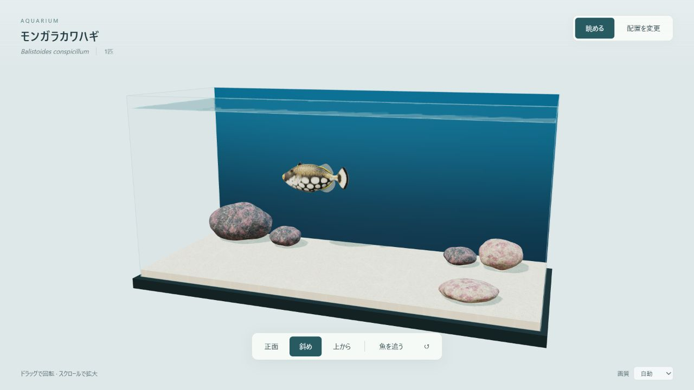
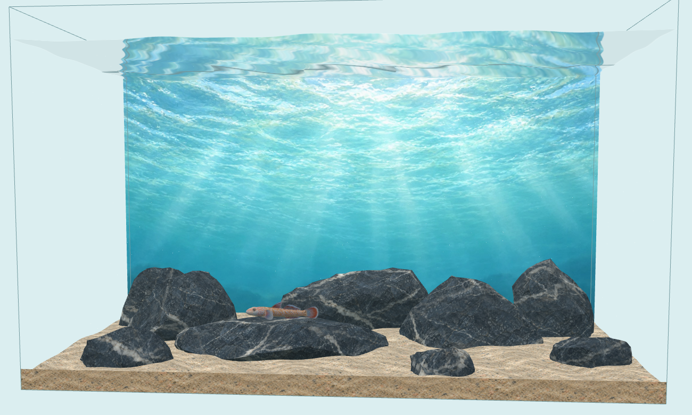
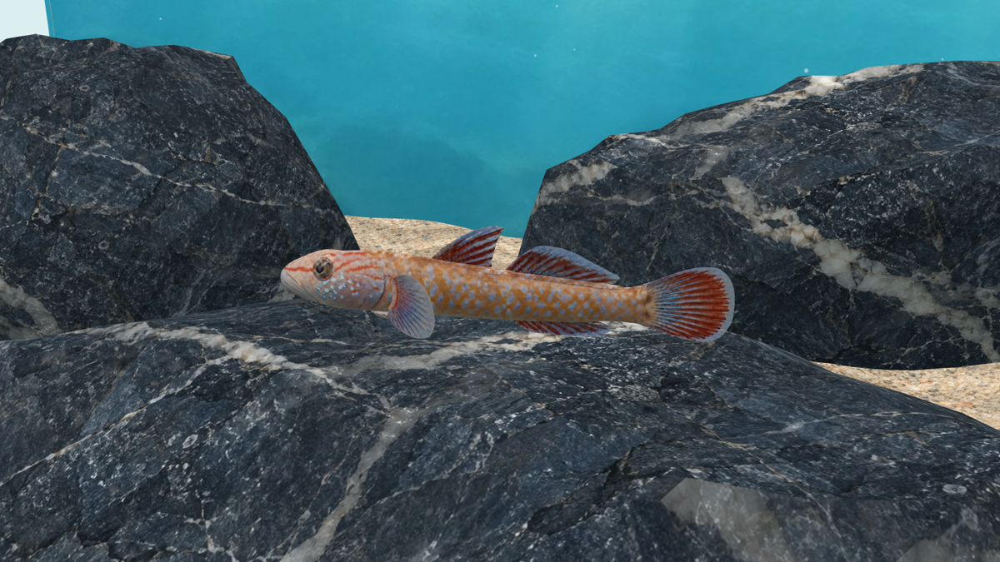
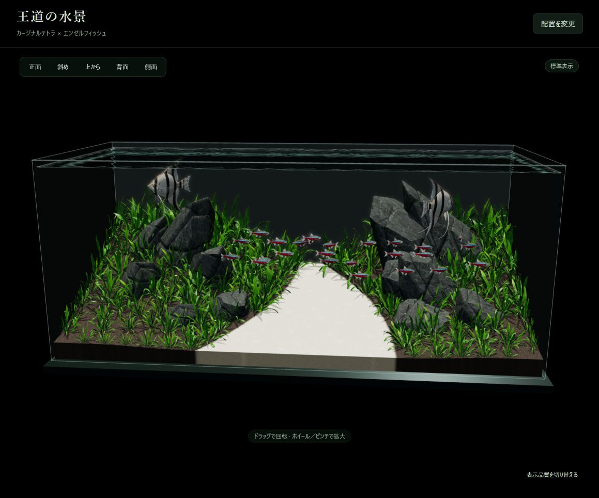

# every-fish-aquarium-generator

> **仮完成版（v0.1）です。** 魚種調査から3D水槽までの一連の流れは作例で動作を確認していますが、手順書・スキルの内容や作例は今後も変わります。
>
> - 3Dモデルは承認まで何度か作り直すことがあり、資料の少ない魚種ほど回数が増えます。
> - 作例の水槽は PC の Chromium で表示を確認しています。スマホ実機ではまだ確認していません。

**ユーザーが明示的に依頼した部分修正は、修正とその確認・再修正を主担当だけで行う。確認のためにサブエージェントを作成・再開・呼び出さない。ユーザーがサブエージェントも合わせた確認を明示的に希望した場合だけ、指定された範囲で共同検品する。** 以下の「共同検品」「全員OKまで反復」は共同検品の場合の規則であり、通常の部分修正には適用しない。初回の魚種調査・画像作成・3Dモデル検品は、開始時にユーザーが選んだ検品体制（共同検品／主担当のみ。希望がなければ主担当のみ）で行う。

魚の種名と写真から、**実在魚種を再現した3Dモデルと3D水槽**を作るためのスキル集。
観賞魚を含む淡水魚・海水魚・深海魚を、回転や拡大ができる水槽で観察する。対象は実在魚種。

動作を確認しているのは Codex と Claude Code。どちらも同じ手順書に従って進める。ほかの AI でも、`AGENTS.md` と `.agents/skills/` の手順書を読んでコマンドを実行できれば使える可能性があるが、まだ確かめていない（専用の対応もしていない）。
**追加のソフトは原則いらない。** AI と、すでに入っているものだけで進め、どうしても必要なときだけ AI が理由を添えて導入を提案する。

## 流れ

```
① 種名・写真（写真は無くても可）と調査（希望すれば学術・ホビーの2担当も参加）
② 側面図を先に承認し、必要な追加方向を生成 …… 全員の検品 OK → ユーザーの OK
③ 承認した図面から可動3Dモデル（GLB） ………… 全員の検品 OK → ユーザーの OK
④ 生息環境に合わせた背景レイアウト案（画像） … ユーザーが OK するまで先へ進まない
⑤ 3D水槽：回転・拡大縮小で観察、1匹を選んで追いかけて観察、レイアウトも変更できる
```

調査と、画像・3Dモデルの検品の体制は、始めるときに選べる（[共同調査・検品の規約](.agents/skills/create-fish-3d-views/references/species-review.md#検品体制をユーザーが選ぶ)）。

- **共同検品**：学術・公的資料担当とホビー資料担当のサブエージェント2体（観賞用改良品種ならホビー資料担当1体）が、調査から生成後の検品まで参加する。誰かがNGなら直し、同じ最新版に全員がOKを出してからユーザーの承認へ進む。資料の少ない魚種や近縁種との見分けが細かい魚種で効果が大きい一方、トークン消費が大きく、出来上がりまで時間がかかる。
- **主担当のみ**（希望がなければこちら）：主担当が両方の資料を調べ、同じ確認項目で検品する。速く軽い。有名な魚種ではこちらで十分なことが多い。

ランチュウ型金魚は側面図と上面図を初回から同時に提示する。

写真は真横でなくてもよく、写っていない部位は鰭に限らず、体の厚み・眼・口・鰓・腹面・付属器官・模様なども、その種の調査資料から推論で補う。写真で確認した特徴と補完した部分・根拠は分けて記録する。

| 工程 | スキル |
|---|---|
| 全体の段取り・承認の記録・環境の確認 | [fish-to-3d-aquarium](.agents/skills/fish-to-3d-aquarium/SKILL.md) |
| ①調査・②三面図 | [create-fish-3d-views](.agents/skills/create-fish-3d-views/SKILL.md) |
| ③3Dモデル | [build-fish-3d-from-views](.agents/skills/build-fish-3d-from-views/SKILL.md) |
| ④レイアウト案・⑤3D水槽 | [build-aquarium-from-fish-model](.agents/skills/build-aquarium-from-fish-model/SKILL.md) |
| ⑤鰭の半透明化 | [make-fish-fins-translucent](.agents/skills/make-fish-fins-translucent/SKILL.md) |
| イラストの画風を保つ | [keep-illustration-style](.agents/skills/keep-illustration-style/SKILL.md) |
| ⑤素材をユーザーの画像生成で作る | [make-aquarium-textures](.agents/skills/make-aquarium-textures/SKILL.md) |
| 公開・共有の書き出し | [publish-aquarium-web](.agents/skills/publish-aquarium-web/SKILL.md) |

標準の③では、体型と模様に合う図面を選び、体型が合う魚に [側面素材から胴体と鰭を組み立てる手順](.agents/skills/build-fish-3d-from-views/references/side-view-assembly.md) を使える。観賞時に見えやすい鰭の半透明、付け根、尾柄を静止時と遊泳時に確認する。

アクアリウム用モデルは、魚種に合う鰭・口・鰓の可動を既定とする。Fish Kitの眼の動きは、リアル調を明示された可動モデルに限り追加する。鰭は側面図・三面図の両フローで、[Fish Kitに近い鰭制御](.agents/skills/build-fish-3d-from-views/references/fin-animation.md)を標準とする。胸鰭の基部からの開閉と滑らかなしなり、背鰭・尻鰭の独立した揺れ、速度・旋回への追従、個体別の位相を魚種に合わせて実装する。単独の静止造形依頼やユーザーの明示指定は優先する。動作をGLBへ保存し、[モデル機能一覧と鰭仕様](.agents/skills/build-fish-3d-from-views/references/model-contract.md)で実装状態と検証範囲を引き継ぐ。水槽では生体をクリック・タップすると個体に寄り、標準和名・学名・短い解説を表示する。特殊な動作は[魚種別アニメーション](.agents/skills/build-fish-3d-from-views/references/species-animation.md)、居付き・混群・地方名の学習表示は[行動・構成・学習情報](.agents/skills/build-aquarium-from-fish-model/references/behavior-and-learning.md)を参照する。

## 環境による違い

| 環境 | ②三面図の画像 | ③3Dモデル |
|---|---|---|
| Codex（画像生成を内蔵） | AI が作る | — |
| Claude Code（画像生成を内蔵していない） | AI がプロンプトを用意し、ユーザーが ChatGPT・Gemini などの画面で作る | — |
| Python・NumPy・Pillow がある | — | 標準：build-fish-3d-from-views で GLB |
| 無い | — | AI が理由を添えて Python・NumPy・Pillow の導入を提案する |

高品質モデルを望む場合だけ、Tripo などの外部3Dツールへの道もある（[external-3d.md](.agents/skills/fish-to-3d-aquarium/references/external-3d.md)）。

## 使い方

Fish Kitのファイルをユーザーが提示する必要はありません。必要な工程では制作側が規定内の参照先を利用します。鰭制御と視線移動の適用条件は下記の規定に従います。

- **Codex**：このフォルダで「オイカワとドジョウの水槽を作りたい。写真はこれ」のように頼む。`.agents/skills/` のスキルが使われる。
- **Claude Code**：同じように頼む。`CLAUDE.md` の指示で、Claude がスキルのファイルを読んで進める。

進み具合と承認の記録は、作業フォルダ（既定は `projects/<水槽名>/`）の `project.json` に残る。会話が途切れても、Codex と Claude Code を替えても続きから進められる。

## 作例

[公開中の水槽の作例一覧（7件）](docs/examples/aquarium-gallery/README.md)では、サムネイルから各水槽を開けます。完成日と制作時の主要モデルも掲載しています。

### Codex での標準作例：モンガラカワハギの水槽



提供写真から三面図・GLBモデル・レイアウト案を順に確認し、観察と石の配置編集ができる水槽を制作した。Codex内蔵の画像生成で三面図と素材を作り、モデルはv5、レイアウトはv2で承認された。

[作例と簡潔なワークフロー](docs/examples/mongara-codex.md)に、工程ごとの確認・形状修正の要点・検証範囲をまとめている。[完成ページ](https://mongara-calm-aquarium-1718.sabinuki1718.chatgpt.site/)は公開中。

### Claude Code での標準作例：ルリヨシノボリの水槽





Claude Code で①〜⑤を通しで進めた作例の一つ。ルリヨシノボリ（*Rhinogobius mizunoi*）1匹が、石や砂の上で止まっては短く泳ぐ。
使ったコードは実装例として手順書に収録している（[モデル](.agents/skills/build-fish-3d-from-views/examples/README.md)・[水槽ページ](.agents/skills/build-aquarium-from-fish-model/examples/README.md)）。

ワークフローの経過は [作例のまとめ](docs/examples/ruri-yoshinobori-claude-code.md) を参照。特に次の2点に注意する。

- **魚と素材の画像は、別の AI で作った。** Claude は画像を生成できないので、三面図・正面図と石・砂・背景の素材は、ユーザーが別の画像生成 AI で作って渡した。
- **3Dモデルの調整は、それなりの回数がかかることがある。** この作例では承認まで6版かかった。AI が持つ知識の少ない、マイナーな魚種ほど、この傾向が強い。

### Codex + Tripo での高品質作例：王道の水景



魚2種と水草のモデルをTripoで生成し、Codexで鰭の透過・形状修正、石と底床の制作、群泳と水面の表現を仕上げた高品質バージョン。チェーンアマゾンのみを使い、中央へ広がる砂道と左右の石組みによる凹型構図を作った。

[作例と制作手順](docs/examples/oudou-tripo-codex.md)に、TripoとCodexの役割分担、生成後の修正、消費クレジットと確認範囲をまとめている。[完成ページ「王道の水景」](https://oudou-aquascape.sabinuki1718.chatgpt.site/)は公開中。

## フォルダ構成

```
.agents/skills/            スキル（Codex はここを自動で読む）
  fish-to-3d-aquarium/     全体の段取り。assets/ に three.js のオフライン版
  create-fish-3d-views/
  build-fish-3d-from-views/
  build-aquarium-from-fish-model/
  make-fish-fins-translucent/
AGENTS.md / CLAUDE.md         Codex・Claude Code への入口
projects/                  作業フォルダの置き場所（使うと作られる。公開版には含めない）
docs/examples/             作例のまとめ
dev/                       開発用（three.js オフライン版のビルドとテスト。利用者は不要）
```

## ライセンス

- 本リポジトリのオリジナルのコード・スクリプトは [MIT License](LICENSE) です。
- 本リポジトリで許諾できる制作手順書、見本画像、3Dモデルは [CC BY-SA 4.0](https://creativecommons.org/licenses/by-sa/4.0/legalcode) です。
- Fish Kitなどの第三者由来の部分は元の利用条件に従います。取り込む場合は出典・版と元のライセンスを記録します。第三者素材や権利が確認できない素材は上記の許諾の対象外です。
- BGMの追加は個別の水槽向けの対応です。標準制作フローや新規配布素材には含めません。本リポジトリの作例には音源を収録していません。
