# 3D水槽作例集 | every-fish-aquarium-generator

[共通の制作フロー](../../../README.md#流れ)　魚種調査 → 図面 → 3Dモデル → レイアウト → 水槽

## 作例一覧

### Codexによる作例

#### 沖縄の海 ― 防波堤の下

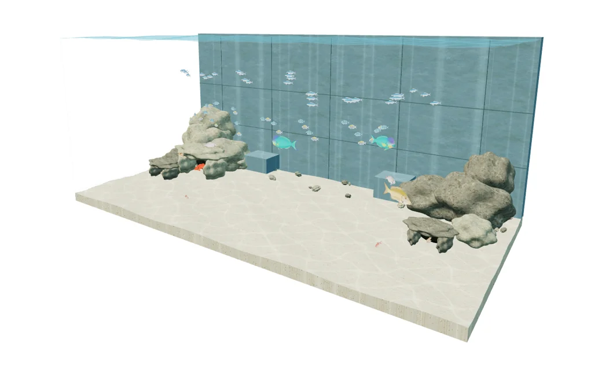

魚種　タカサゴ、オヤビッチャ、ロクセンスズメダイ、オジサン、ハリセンボン、シロダイ、スジアラ、カンモンハタ、ナンヨウブダイ、ハマフエフキ（タマン）

完成日　2026-11-13　｜　主要モデル　GPT-6.1 Sol

[3D水槽を開く ↗](aquariums/okinawa/)

#### モンガラカワハギの水槽

魚種　モンガラカワハギ

完成日　2026-10-28　｜　主要モデル　GPT-6.1 Sol

[3D水槽を開く ↗](aquariums/mongara/)

#### ダンゴウオとホンダワラの磯

魚種　ダンゴウオ

完成日　2026-10-26　｜　主要モデル　GPT-6.1 Sol

[3D水槽を開く ↗](aquariums/dangouo/)

#### 王道の水景

魚種　カージナルテトラ、エンゼルフィッシュ

完成日　2026-10-24　｜　主要モデル　GPT-6.1 Sol

[3D水槽を開く ↗](aquariums/oudou/)

#### 6月の琵琶湖湖岸

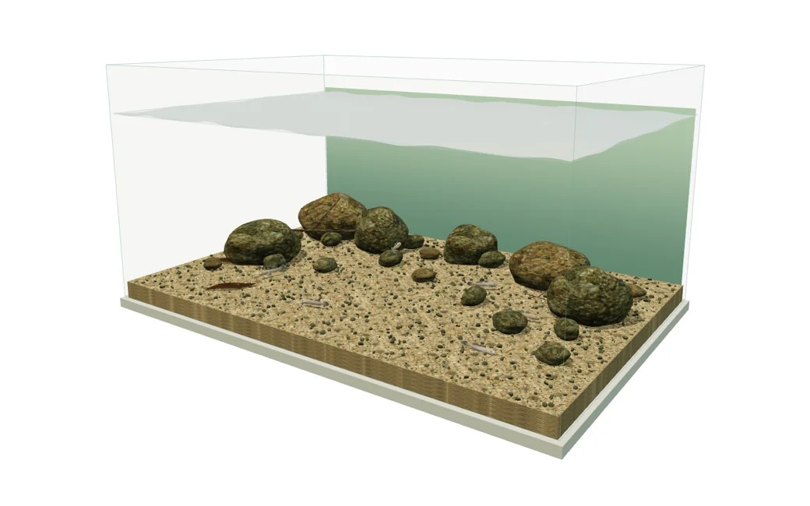

魚種　ビワヨシノボリ

完成日　2026-10-23　｜　主要モデル　GPT-6.1 Sol

[3D水槽を開く ↗](aquariums/biwa/)

#### イソギンポの水景

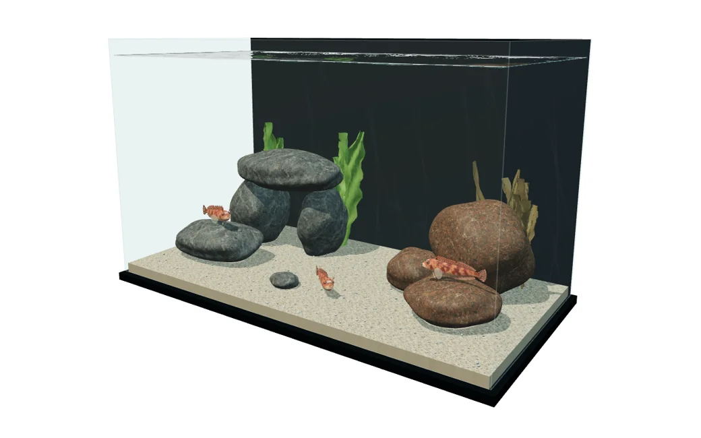

魚種　イソギンポ

完成日　2026-10-22　｜　主要モデル　GPT-6.1 Sol

[3D水槽を開く ↗](aquariums/isoginpo/)

#### チョウセンブナの水景

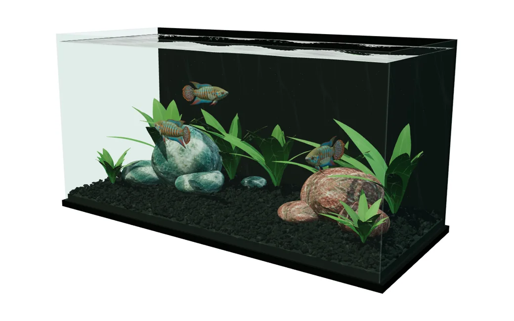

魚種　チョウセンブナ

完成日　2026-10-22　｜　主要モデル　GPT-6.1 Sol

[3D水槽を開く ↗](aquariums/chousenbuna/)

### Claude Codeによる作例

Claude には画像生成が内蔵されていないため、三面図や素材画像はユーザーが別の画像生成サービスで作り、Claude Code に渡しました。「画像生成」には使ったサービスを記載しています（複数使った場合は最初に使ったもの）。

#### 青色金魚絵巻

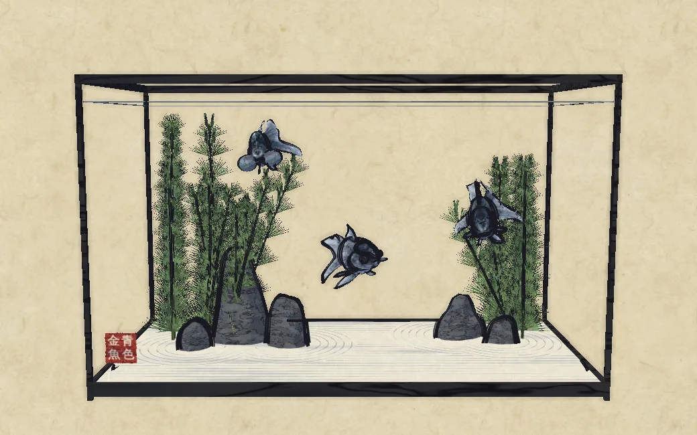

魚種　青文魚、穂竜、銀水泡眼

完成日　2026-11-27　｜　主要モデル　Claude Opus 5.5　｜　画像生成　ChatGPT

[3D水槽を開く ↗](aquariums/emaki-seibungyo/)

#### トリファスキアータのブリードタンク

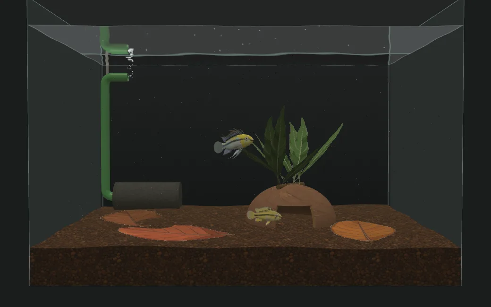

魚種　アピストグラマ・トリファスキアータ

完成日　2026-11-24　｜　主要モデル　Claude Opus 5.5　｜　画像生成　Gemini

[3D水槽を開く ↗](aquariums/breed-tank/)

#### ムツゴロウの干潟水槽

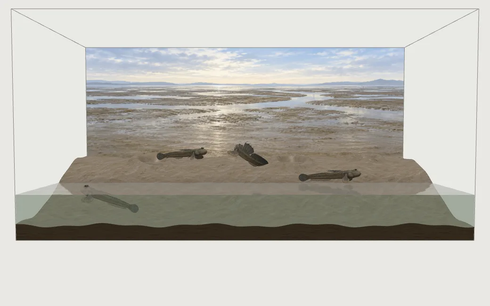

魚種　ムツゴロウ

完成日　2026-11-01　｜　主要モデル　Claude Opus 5.5　｜　画像生成　Meta AI

[3D水槽を開く ↗](aquariums/mutsugoro/)

#### 深海の水槽

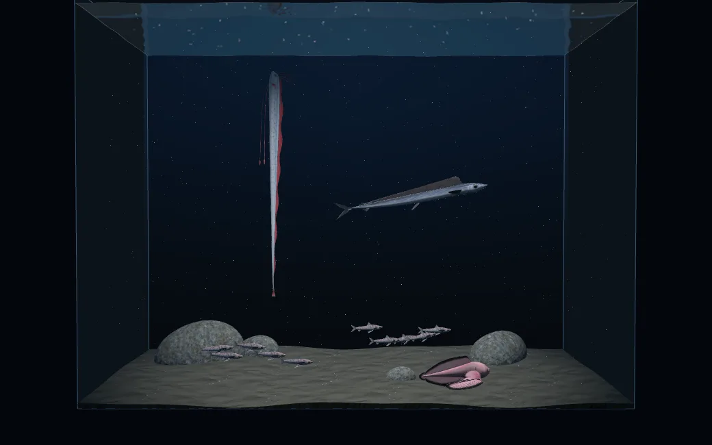

魚種　リュウグウノツカイ、オトヒメコンニャクウオ、ミズウオ、メヒカリ

完成日　2026-11-01　｜　主要モデル　Claude Opus 5.5　｜　画像生成　ChatGPT

[3D水槽を開く ↗](aquariums/deep-sea/)

#### アカマンボウとウツボの水槽

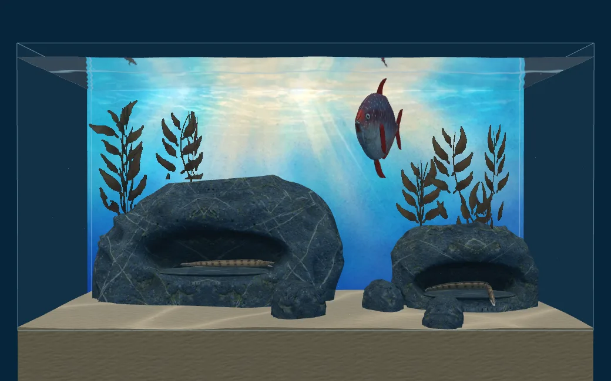

魚種　アカマンボウ、ウツボ

完成日　2026-10-29　｜　主要モデル　Claude Opus 5.5　｜　画像生成　Meta AI

[3D水槽を開く ↗](aquariums/opah-moray/)

#### ルリヨシノボリの水槽

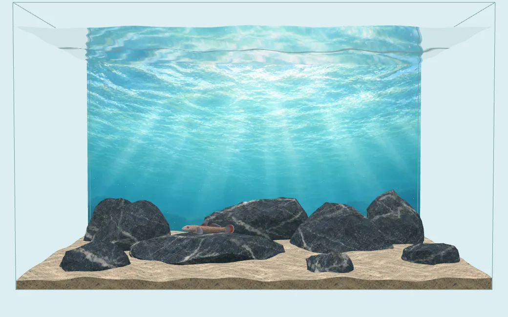

魚種　ルリヨシノボリ

完成日　2026-10-28　｜　主要モデル　Claude Opus 5.5　｜　画像生成　ChatGPT

[3D水槽を開く ↗](aquariums/ruri-yoshinobori-cc/)

#### ヨシキリザメの大水槽

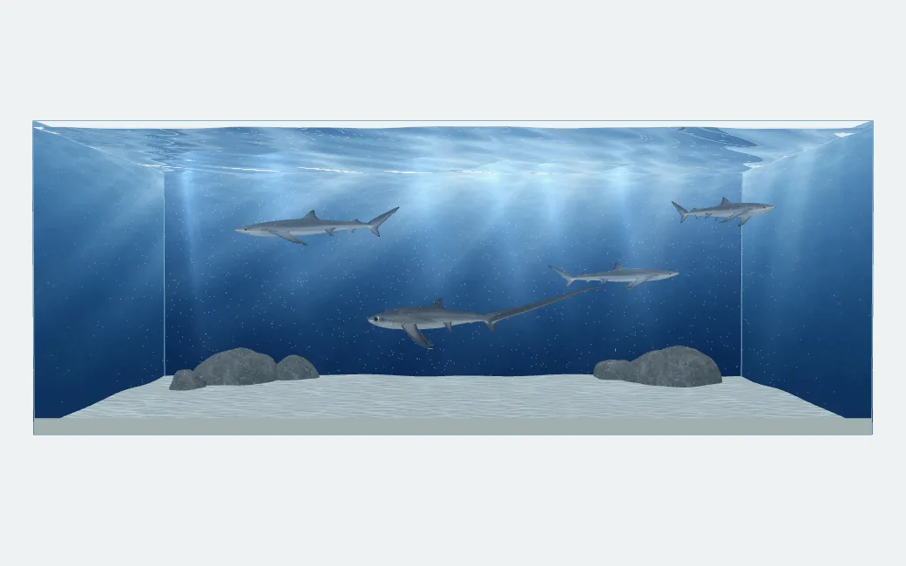

魚種　ヨシキリザメ、ハチワレ

完成日　2026-10-27　｜　主要モデル　Claude Opus 5.5　｜　画像生成　ChatGPT

[3D水槽を開く ↗](aquariums/blue-shark/)

#### シマウミヘビとマアナゴの水槽

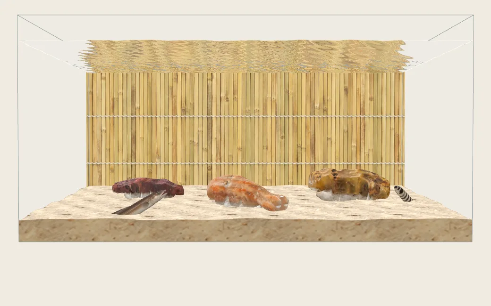

魚種　シマウミヘビ、マアナゴ

完成日　2026-10-27　｜　主要モデル　Claude Opus 5.5　｜　画像生成　ChatGPT

[3D水槽を開く ↗](aquariums/snake-eel-conger/)

#### グッピーの水草水槽

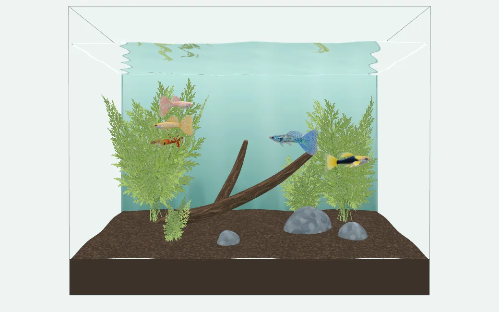

魚種　グッピー（ゴールデンキングコブラ）、グッピー（ギャラクシーブルーグラス）、グッピー（RREAレッドグラスリボン）、グッピー（サンセットドイツイエロータキシード）、グッピー（マーブルマゼンタ）

完成日　2026-10-27　｜　主要モデル　Claude Opus 5.5　｜　画像生成　Gemini

[3D水槽を開く ↗](aquariums/guppy/)

#### 水彩の金魚水槽

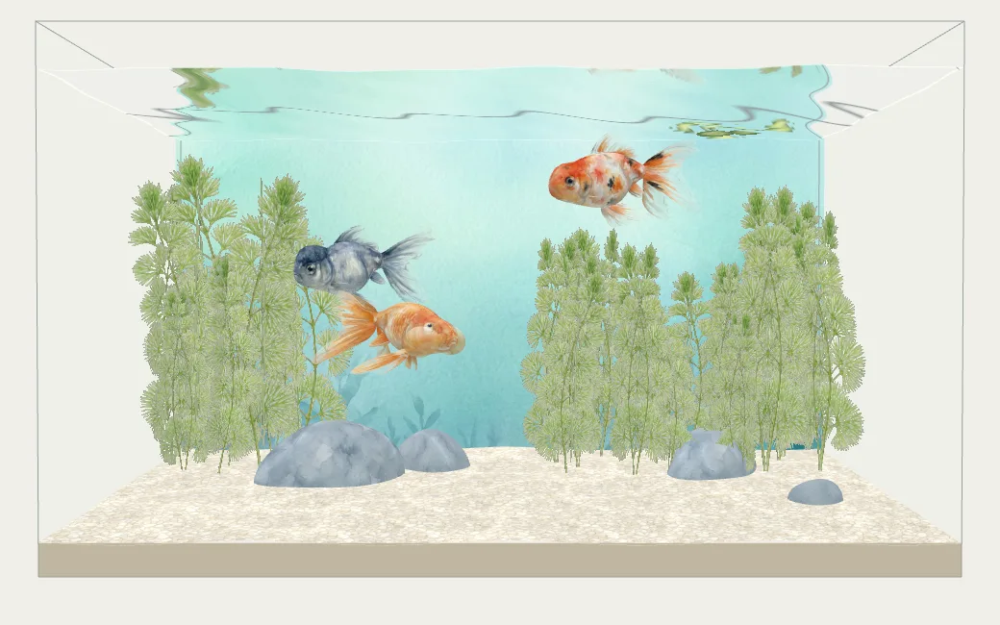

魚種　青文魚、水泡眼、東錦

完成日　2026-10-24　｜　主要モデル　Claude Opus 5.5　｜　画像生成　Gemini

[3D水槽を開く ↗](aquariums/goldfish/)

#### 防波堤の下の海

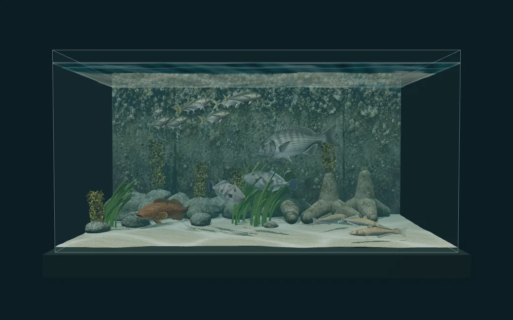

魚種　マアジ、シロギス、クロダイ、ウマヅラハギ、キジハタ

完成日　2026-10-23　｜　主要モデル　Claude Opus 5.5　｜　画像生成　ChatGPT

[3D水槽を開く ↗](aquariums/breakwater/)

### Museによる作例

無料で作れる選択肢。Meta AI の Muse でも、魚種調査から3D水槽まで一通り作れました。

#### ハタタテハゼの水槽

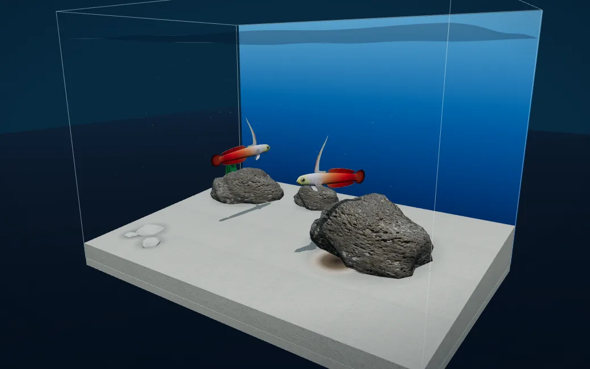

魚種　ハタタテハゼ

完成日　2026-11-24　｜　主要モデル　Muse　｜　費用　無料

[3D水槽を開く ↗](https://sabinuki1718.github.io/every-fish-aquarium-preview/examples/aquarium-gallery/aquariums/hatatate-haze/)（このリポジトリの [aquariums/hatatate-haze/index.html](aquariums/hatatate-haze/index.html) を GitHub Pages で公開）

## ライセンス

ここに掲載した作例（3Dモデル・画像・テクスチャ・BGMなどの素材）は許諾の対象外です（複製・再配布・改変・転用はできません）。コード・スクリプトは MIT License です。詳しくは[リポジトリの README](../../../README.md#ライセンス)を参照してください。
