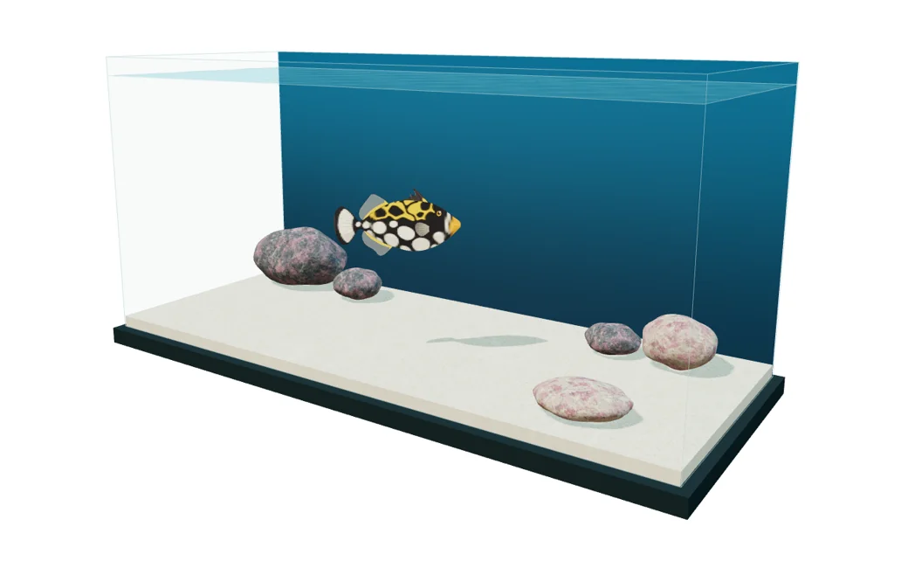
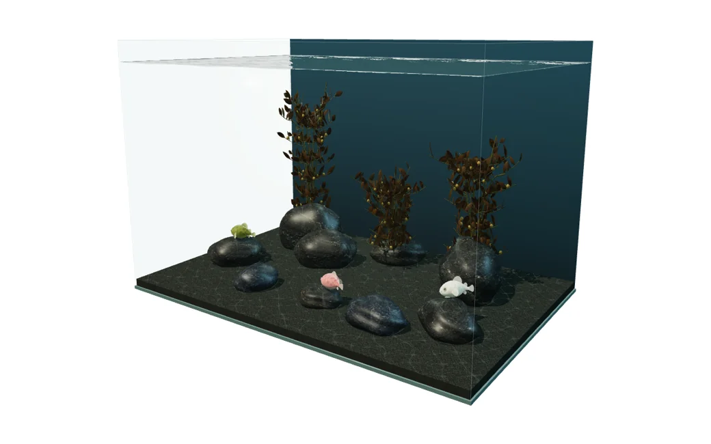
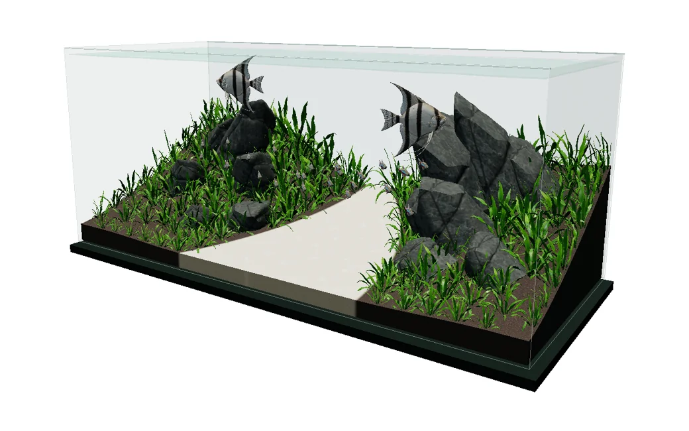

# 3D水槽作例集 | every-fish-aquarium-generator

[共通の制作フロー](../../../README.md#流れ)　魚種調査 → 図面 → 3Dモデル → レイアウト → 水槽

## 作例一覧

### Codexによる作例

#### 沖縄の海 ― 防波堤の下

魚種　タカサゴ、オヤビッチャ、ロクセンスズメダイ、オジサン、ハリセンボン、シロダイ、スジアラ、カンモンハタ、ナンヨウブダイ、ハマフエフキ（タマン）

完成日　2026-11-13　｜　主要モデル　GPT-6.1 Sol

[3D水槽を開く ↗](https://okinawa-harbor-aquarium.sabinuki1718.chatgpt.site)

#### モンガラカワハギの水槽

魚種　モンガラカワハギ

完成日　2026-10-28　｜　主要モデル　GPT-6.1 Sol

[3D水槽を開く ↗](https://mongara-calm-aquarium-1718.sabinuki1718.chatgpt.site)

#### ダンゴウオとホンダワラの磯

魚種　ダンゴウオ

完成日　2026-10-26　｜　主要モデル　GPT-6.1 Sol

[3D水槽を開く ↗](https://dangouo-sargassum-shore.sabinuki1718.chatgpt.site)

#### 王道の水景

魚種　カージナルテトラ、エンゼルフィッシュ

完成日　2026-10-24　｜　主要モデル　GPT-6.1 Sol

[3D水槽を開く ↗](https://oudou-aquascape.sabinuki1718.chatgpt.site)

#### 6月の琵琶湖湖岸

魚種　ビワヨシノボリ

完成日　2026-10-23　｜　主要モデル　GPT-6.1 Sol

[3D水槽を開く ↗](https://biwa-june-goby-aquarium.sabinuki1718.chatgpt.site)

#### イソギンポの水景

魚種　イソギンポ

完成日　2026-10-22　｜　主要モデル　GPT-6.1 Sol

[3D水槽を開く ↗](https://isoginpo-rocky-aquarium.sabinuki1718.chatgpt.site)

#### チョウセンブナの水景

魚種　チョウセンブナ

完成日　2026-10-22　｜　主要モデル　GPT-6.1 Sol

[3D水槽を開く ↗](https://chousenbuna-aquarium-1022.sabinuki1718.chatgpt.site)
