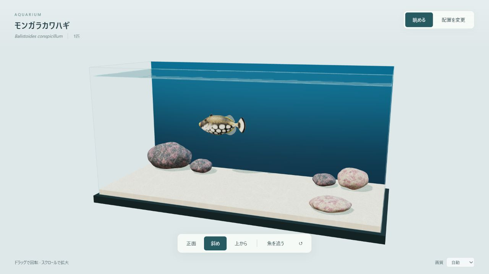

# 標準作例：モンガラカワハギの水槽（Codex）

ユーザー提供の写真から、モンガラカワハギ（*Balistoides conspicillum*）1匹の3Dモデルと、観察・配置編集ができる水槽を制作した。三面図・モデル・レイアウトの各段階で確認と修正を行う、Codexでの標準作例とする。

- [完成ページ](https://mongara-calm-aquarium-1718.sabinuki1718.chatgpt.site/)：公開ページ。
- 構成：青い背景、白砂、石灰藻を部分的に付けた石5個。中央に遊泳空間を確保した。
- 使用環境：Codex、内蔵画像生成、既存のPython環境、Three.js r170。外部3D生成サービスは使っていない。
- 記録対象：承認済みの三面図v4・モデルv5・レイアウトv2を用いた水槽。

## 制作の流れ

| 工程 | 今回行ったこと | 次へ進む条件 |
|---|---|---|
| 1. 写真と特徴の整理 | 提供写真を基準に、体形・白い斑・背鰭・尾柄・口と目の位置を整理する。 | 再現する特徴と不確かな部分を区別する。 |
| 2. 三面図 | 側面・上面・下面を作成。第1背鰭の黒い鰭膜、中央線上の背鰭、上下面の口先を修正した。 | 画像を提示し、ユーザーのOKを記録する。採用版はv4。 |
| 3. GLBモデル | 輪郭と断面から形状を組み、画像を加工してUVへ焼き込む。多方向の静止画と回転プレビューで修正する。 | ユーザーのOKを記録する。採用版はv5（5版を提示）。 |
| 4. レイアウト案 | 「おまかせ」の希望から青背景・白砂・少数の石を提案。追加依頼を反映し、小石3個を増やして全5個にした。各石に石灰藻を付ける。 | 案の画像を提示し、v2へのOKを記録する。 |
| 5. 水槽実装 | 承認済みGLBを読み込み、遊泳・鰭・水面の反射と屈折・揺れる光を実装。石肌2色と砂の画像を内蔵画像生成で作り、3D材質に適用する。 | 配置・匹数・配色が承認案と一致し、実画面で動作する。 |
| 6. 検証・納品 | 視点変更・追尾・石の編集・保存と復帰・軽量表示を確認し、Web版、通信不要HTML、ソース、実画面の画像と検証記録をまとめる。 | 配信成功と通信不要版の表示をそれぞれ確認する。 |

工程の段取りは [fish-to-3d-aquarium](../../.agents/skills/fish-to-3d-aquarium/SKILL.md) に従う。三面図・GLB・レイアウトの承認対象とユーザーの言葉を `project.json` に残し、承認済み原本を保持する。

## 修正から得た確認点

| 起きた問題 | 再利用する対処・確認 |
|---|---|
| 頭部の重なりを除くと穴が開いた | 表面を単に削除せず、頭部の断面と面の接続を修正する。正面・斜めでも閉じた表面を確認する。 |
| 胸鰭や目が二重に見えた | 立体を追加する前に、胴体テクスチャに焼き込まれた同じ部位を除き、周囲の体模様を補う。 |
| 尾柄部が二重になった | 胴体・尾柄・尾を連続した断面でつなぎ、重複する接合面を作らない。 |
| 背鰭と尻鰭が小さくなったり浮いた | 胴体の輪郭と鰭の輪郭を分けて採寸する。鰭全体を保持し、基部を体表へ接続して、隙間と過度な埋没の両方を確認する。 |
| 上面から目や背鰭の位置が不自然だった | 左右の目を局所的な体表の向きに沿わせ、背鰭は中央線上へ置く。側面だけで合格にせず、上面・下面・正面・背面も確認する。 |

第1背鰭は黒を主体とし、黄色は第1棘条の根元だけにする。上面・下面の口先に不要な切れ込みを作らない。修正のたびに指摘箇所と既に承認された形の両方を再確認し、版を保存してから提示する。

## 動きと操作の確認基準

- **魚種の泳ぎ方を確認する。** この仲間の通常の低速遊泳では、柔らかい第2背鰭と尻鰭を主な推進に使い、胴体と尾を比較的安定させる。第1背鰭の棘とは区別する。[George & Westneat（2019）](https://journals.biologists.com/jeb/article/222/8/jeb194704/34045/Functional-morphology-of-endurance-swimming)
- **形と動きを別々に確認する。** 鰭の透け・鰭条・左右の開閉、基部の接続、胴体へのめり込み、壁や石との接触を見る。鰭主体の推進・姿勢制御の分かりやすさは追加の確認項目とする。公開版を実測に基づく生体力学シミュレーションとは扱わない。
- **編集後も初期状態へ戻せるようにする。** 石の移動・向き・個別色と一括色、保存後の再読込、承認配置への復帰を確認する。保存先はブラウザのlocalStorageで、Web版と通信不要版では別になる。

## 検証と保存するもの

PCでは正面・上面・斜め・追尾、石のドラッグとスライダー、一括色変更後の個別変更、保存後の再読込、初期復帰を確認した。390×844の表示と軽量モードも確認したが、スマートフォン実機GPUでは未検証。

モデルv5は8個の閉じたメッシュ、左右1枚ずつの胸鰭、連続した尾柄を数値確認した。遊泳経路は250秒・1001点で壁・底・水面への接触を検査した。数値検査と実画面の確認は併用する。

納品では、`project.json`、承認した三面図・GLB・配置JSONと案の画像、生成素材とプロンプト、実装ソース、通信不要HTML、スクリーンショット、検証記録を保存する。この作例文書には完成画面と工程を収録し、大容量のモデル・実行HTMLや個人のローカルパスは含めていない。水槽寸法160×65×75 cmと魚の全長30 cmは表示用の仮想スケールであり、飼育条件の指定ではない。
