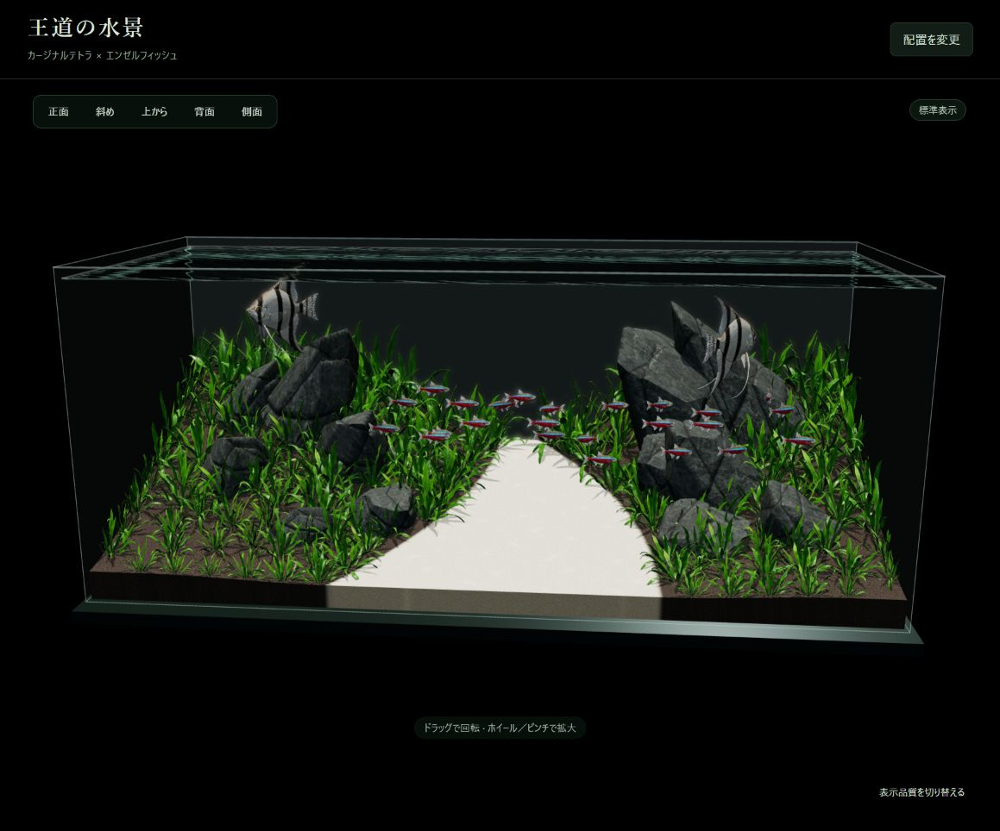

# 高品質作例：王道の水景（Codex + Tripo）

カージナルテトラ24匹、エンゼルフィッシュ2匹、チェーンアマゾン144株を配置した、石組みと水草の凹型水景。魚と水草の形状はTripoで生成し、Codexで修正・軽量化・水槽への組み込みを行った。

- [完成ページ「王道の水景」](https://oudou-aquascape.sabinuki1718.chatgpt.site/)：公開ページ。
- 制作：Codex、内蔵画像生成、Tripo CLI/API、Three.js。
- 構成：チェーンアマゾンのみを使用。石13個、奥へ高くなる底床、手前へ広がる曲線の白砂道、黒い外背景と上方照明、半透明のすりガラス調バックスクリーン。
- 「高品質」はこの作例の制作方法を示す区分。標準作例から外部3D生成を使う場合の選択肢であり、Tripoの自動出力だけで完成したものではない。

## TripoとCodexの役割分担

| 対象 | Tripo | Codexで行ったこと |
|---|---|---|
| カージナルテトラ | 参照図からGLBを生成 | 胸鰭の不要な体色を透過処理し、背鰭の突起を除去。軽量化して群泳と尾振りを付ける。 |
| エンゼルフィッシュ | 参照図からGLBを生成 | 胸鰭の透過処理、軽量化、ゆったりした遊泳と姿勢変化を付ける。 |
| チェーンアマゾン | 参照画像からGLBを生成 | 複製と個体ごとのサイズ変更。奥ほど高く、縁や斜面にも植える。根を埋め、水槽外にはみ出す葉を非表示にする。 |
| 石・底床・水槽 | 使用しない | 石の形状・ひび割れ、生成した石肌・砂・ソイルの画像を使った材質、地形、水面、照明、ガラスを制作する。 |

外部3D生成はユーザーが高品質化を希望した段階で採用した。基本の進め方と承認工程は [fish-to-3d-aquarium](../../.agents/skills/fish-to-3d-aquarium/SKILL.md)、外部サービスの扱いは [external-3d.md](../../.agents/skills/fish-to-3d-aquarium/references/external-3d.md) を参照する。

## 制作の流れ

1. **参照図を用意する。** 魚2種のフォトリアル調の三面図と、チェーンアマゾンの参照画像を用意する。レイアウトはユーザーが提示した水景画像を基準にする。
2. **魚と水草を生成する。** Tripoで3種類のGLBを生成する。この作例の生成記録はH3.1、geometry/textureともにdetailed、PBRあり。
3. **生成結果を局所修正する。** 胸鰭に残った体色やカージナルテトラの背鰭の突起をローカルで直す。ここではTripoの再生成を行わなかった。
4. **表示用モデルを軽量化する。** 表示用のテクスチャを1024pxにし、モデルを最適化。水草はインスタンス描画で複製する。原本は保持する。
5. **レイアウトを仕上げる。** 背面のソイルを約25cmまで盛り、砂道へ下る左右の斜面は幅約28〜31cmでなだらかにつなぐ。砂道は奥約6cm、手前約49cmへ広げ、右岸にも緩い曲線を付ける。
6. **石・植栽・動きを調整する。** 石の先端を中央へ26〜43度傾け、砂道にはみ出さない位置へ移す。水草は大小差を残しながら手前約5〜7cm、奥約11〜14cmの背丈になる傾向を付ける。
7. **観察用のWebページにする。** 視点切替、拡大縮小、石だけの配置変更・配色・保存と初期復帰、通常／軽量表示を実装し、GPT Siteへ配信する。

記載した寸法は仮想水槽の表示スケールであり、実際の飼育条件を指定するものではない。

## 生成クレジットの記録

| 生成対象 | この作例で消費したTripoクレジット |
|---|---:|
| カージナルテトラ | 60 |
| エンゼルフィッシュ | 60 |
| チェーンアマゾン | 60 |
| **合計** | **180** |

2026年10月24日の生成記録に基づく実績。料金表や他の設定での見積もりを示すものではない。以後の鰭・突起・石・底床・群泳・表示の修正ではTripoを再生成せず、追加のTripoクレジットは消費していない。

## 修正から得た確認点

| 起きた問題 | 行った修正 |
|---|---|
| 胸鰭に胴体の色が残る、背鰭に不要な突起が出る | 生成原本を保持し、鰭の材質・局所形状をローカルで直す。 |
| 群泳が規則的で、石の周囲で機械的に切り替わる | 固定周回をやめ、個体間の間隔・進行方向・揺らぎと進行先の予測回避から加速度を求める。 |
| 底床が平坦で奥行きが弱い | 背面を高く盛り、左右の斜面を広げ、手前へ開く曲線の砂道にする。地形の定義を植栽・地下判定・魚の回避で共有する。 |
| 石が砂道にはみ出し、先端が上を向いてそろう | 傾斜後の形状を砂の境界と比較して移動し、左右の先端を中央へ向ける。 |
| 水草が均一で根や葉が水槽外へ見える | 大小と前後の背丈を調整。根を埋め、水槽の範囲外は描画しない。配置編集は石だけにする。 |
| 背面から見た砂の断面がちらつく | 内部の土台と外周断面が重なる面を離す。前面の重複した砂の断面も取り除く。 |

## 確認範囲と操作

制作時にPCのCodex内ブラウザで、正面・上面・斜め・背面・側面、石の編集と色変更、保存と初期復帰、通常／軽量表示を確認した。魚の回避は膨らませた楕円体による近似で、葉1枚ごとの衝突は扱わない。スマートフォン実機GPUでは未確認。

- ドラッグで回転、ホイール／ピンチで拡大縮小。
- 視点ボタンで正面・斜め・上から・背面・側面へ移動。
- 「配置を変更」で石だけを選択・移動・回転・配色変更。水草は固定。
- 配置はブラウザのlocalStorageへ保存。ブラウザやURLを変えると保存内容は共有されない。
- 魚の動きは実行時の形状変形で付けており、GLBへ骨やアニメーションクリップを追加したものではない。

この文書には完成画面と制作手順を収録する。大容量のモデル・実行HTML、認証情報や個人のローカルパスは含めていない。
