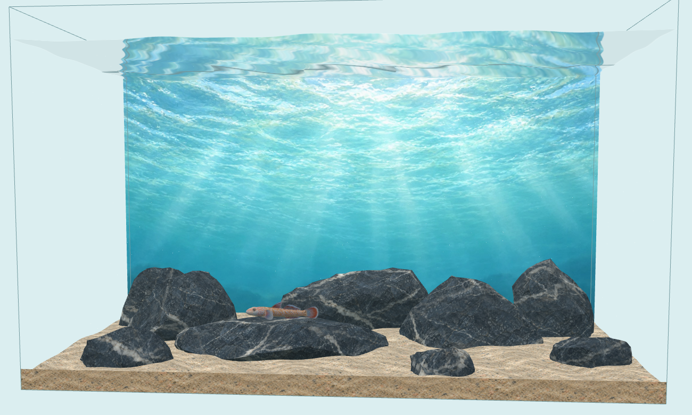
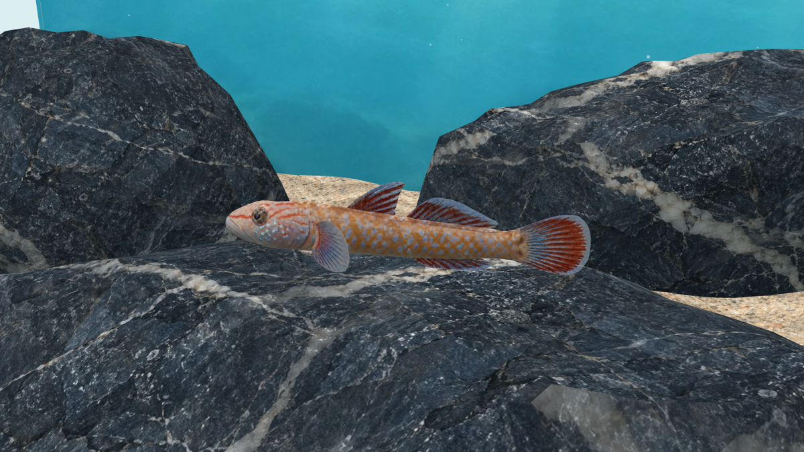

# 作例：ルリヨシノボリの水槽（Claude Code）

Claude Code でこのワークフローを通しで進めた、標準作例の一つ。ルリヨシノボリ（*Rhinogobius mizunoi*）1匹が、上流の瀬の砂底に置いた青黒い角石の上で、止まっては短く泳ぐ水槽を作った。

- この公開版には、作業フォルダ（写真・三面図・素材・モデル・完成した水槽）は含めていない。進み具合と承認の言葉は、作業フォルダの `project.json` の `history` に記録した。
- 使ったコードは実装例として収録している：モデルの組み立て [`build-fish-3d-from-views/examples/rhinogobius-mizunoi/`](../../.agents/skills/build-fish-3d-from-views/examples/rhinogobius-mizunoi/)、水槽ページ [`build-aquarium-from-fish-model/examples/ruri-yoshinobori/`](../../.agents/skills/build-aquarium-from-fish-model/examples/ruri-yoshinobori/)

## 先に知っておくこと

### 魚や素材の画像は、別の AI で作った

Claude には画像生成が内蔵されていない。この作例でも、画像はすべてユーザーが別の画像生成 AI の画面で作り、Claude に渡した。

| 画像 | 作った人 | Claude がしたこと |
|---|---|---|
| ②三面図・正面図 | ユーザー（別の画像生成 AI、同じワークフローの手順で作成） | 受け取って確認し、3Dモデルの資料にした |
| ④レイアウト案 | Claude（承認済みの3Dモデルを並べた簡易レンダー） | 画像生成は使っていない |
| ⑤石・砂・背景の素材4枚 | ユーザー（4枚をまとめて生成できる AI） | プロンプトを英語・日本語で用意し、届いた画像を継ぎ目なしに加工して貼った |

Codex など画像生成を内蔵した AI なら、これらの画像も AI 自身が作る（[画像生成](../../.agents/skills/fish-to-3d-aquarium/references/image-generation.md)）。

### 3Dモデルの調整は、それなりの回数がかかることがある

この作例では、3Dモデルの承認までに **6版** かかった（下の「③3Dモデル」）。三面図は1枚の絵なので、側面・背面・腹面の大きさや模様の位置が少しずつ食い違う。どこを優先し、どこを推測で補うかを、見比べながら決めていく必要がある。

**AI が持っている知識の少ない、マイナーな魚種ほど、この傾向が強い。** 有名な魚なら AI が体形や模様の「ふつう」を知っていて補いやすい。一方、ルリヨシノボリのように2017年に記載された種や、近い種との違いが細かい魚では、その補いがきかない。三面図とユーザーの指摘だけが頼りになるので、細部（眼の前の V 字の交わる位置、胸鰭の形、口先など）の修正が何度か必要になる。

修正を重ねても承認済みの部分は作り直さず、指摘された場所だけを直していく。各版は上書きせずに残す。

## 流れ

### ①調査

学名、同定形質（頬の瑠璃色の斑、伸びた第1背鰭、尾鰭の付け根の暗斑、吸盤になった腹鰭）、生息環境（川の中流から上流の速い瀬、石や礫の底）を調べ、作業フォルダの `research.md` にまとめた。

### ②三面図

ユーザーが同じワークフローで作った三面図（側面・背面・腹面の1枚）を使った。③の途中で、正面図も追加で作ってもらった。

### ③3Dモデル（6版）

組み立ては [`build.py`](../../.agents/skills/build-fish-3d-from-views/examples/rhinogobius-mizunoi/build.py) と、輪郭・目印を読み取った `landmarks.json` で行った（Python・NumPy・Pillow）。

| 版 | ユーザーの指摘 | 直したこと |
|---|---|---|
| v1 | — | 三面図から最初の形。 |
| v2 | 正面から見たとき歪んでいる。正面図を作ったので反映して | 頭の断面を正面図に合わせ、顔に正面図を貼った。**→ 寄せすぎて別の魚になった** |
| v3 | 歪みすぎて別物。横顔を優先し、他の角度は補正用に | 側面図を基準に戻し、正面図は形を半分弱だけ寄せる補正に使った（絵は貼らない） |
| v4 | V字のバンドが二重。眼と口先がやや歪む | 背面図の V 字を消して側面図の線を濃くした。眼を描かれた位置に合わせ、吻の先を丸く閉じた |
| v5 | V字は唇の手前で交わるように。口先のぼかし。胸鰭を1枚のうちわに | V 字の両枝を表面に沿って延ばし、唇の手前で交わらせた。胸鰭を平らな扇にした |
| v6 | 唇を縦に引き伸ばしたような跡。胸鰭の上に体側の切り残し | 頭頂の断面を丸め、輪郭線を体表に貼らないようにした。胸鰭の輪郭を描かれた扇の縁で取り直した → **承認** |

v2 のように、補助の図（正面図）に寄せすぎると、承認済みの横顔が崩れることがある。この作例での決め方は「**横顔（側面図）を基準にして、ほかの方向は補正にだけ使う**」だった。

### ④レイアウト案（4版）

承認済みのモデルを並べた簡易レンダーで提示した。

| 版 | ユーザーの指摘 | 内容 |
|---|---|---|
| v1 | — | 背景の希望がなかったので、生息環境から選んだ：澄んだ瀬、丸い川石8個、川砂利 |
| v2 | 上流域のゴツゴツした石に。濃い青黒に白い帯が入る石 | 角ばった石にし、白い石英の帯を入れた |
| v3 | 底床は砂に。ゴツゴツした石を多めに | 砂だけの底にし、石を15個にした |
| v4 | 石を全体に大きく、数を減らす | 大きな角石を9個にした → **承認** |

### ⑤3D水槽

- 素材の画像が届く前に、仮の素材で水槽の本体（石・砂・水面・川底の光の模様・魚の動き・配置の編集・スマホ用の軽量表示）を作り、待ち時間を使った。
- ユーザーが作った素材4枚（石2色・砂・背景）を、継ぎ目なしに加工して貼った。
- 完成後の指摘と修正：
  - 動きが直線的 → 弧を描く道筋、強い蹴り・惰性・小さな蹴り・着地の緩急、止まっている間の胸鰭の動き
  - 側面や下から砂が透ける → 砂を厚みのある層にした

## かかったやり取り

| 工程 | 提示した版 | ユーザーの修正依頼 |
|---|---|---|
| ③3Dモデル | 6 | 5回 |
| ④レイアウト案 | 4 | 3回 |
| ⑤3D水槽 | — | 素材の受け渡し1回、完成後の修正1回 |

すべての依頼と承認の言葉は、作業フォルダの `project.json` の `history` に記録した。
